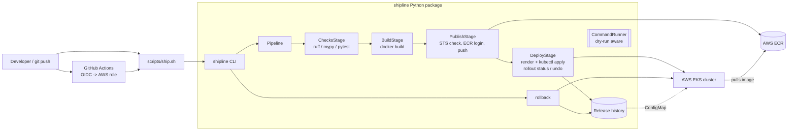

# ShipLine

A CI/CD deployment pipeline in Python and Shell. One command takes a service from source to a
running Kubernetes Deployment on **AWS EKS**:

```
static analysis -> pytest -> docker build -> push to AWS ECR -> kubectl apply on EKS -> wait for rollout
```

Every release gets an immutable tag (`<git-sha>-<UTC timestamp>`) and is recorded in a
release history kept inside the cluster. You can roll back to the previous good release, or
to any tag you name, with one command. If a rollout fails its readiness checks, ShipLine
reverts it on its own.

## Features

- **Quality gate**: runs ruff, mypy (optional) and pytest. pytest writes a JUnit XML report. Any failure stops the pipeline before an image is built.
- **Immutable images**: tags are built from the git SHA (with `-dirty` added when the tree has uncommitted changes) and a timestamp. `latest` is never used. ShipLine creates the ECR repo with `IMMUTABLE` tags and scan-on-push.
- **Safe ECR auth**: checks `sts get-caller-identity` against the configured account, then logs in with `get-login-password | docker login --password-stdin`. The secret is never passed as a command-line argument.
- **EKS deploy**: runs `aws eks update-kubeconfig`, renders `${VAR}` templates from `k8s/` and applies them with `kubectl apply`. It records the change-cause, then waits on `kubectl rollout status`.
- **Auto-revert**: if a rollout times out, ShipLine runs `kubectl rollout undo` and records the release as `failed`.
- **Tagged rollbacks**: `shipline rollback` steps back through successful deploys (C -> B -> A). `--to TAG` targets a specific release. `--force` also accepts any tag that exists in ECR.
- **Release history**: kept in the `shipline-releases-<app>` ConfigMap, so any CI runner or operator can roll back. A local JSON file is also supported.
- **Dry run**: `--dry-run` prints every mutating command and the rendered manifests. Read-only checks still run.

## Architecture



All external tools (`docker`, `aws`, `kubectl`, `pytest`, `ruff`, `mypy`) are called through
one `CommandRunner`. That gives a single place for dry-run behaviour, logging, and keeping
secrets out of argument lists. It also lets the test suite swap in a fake runner.

### Layout

```
shipline/
  cli.py           argparse CLI: validate, check, build, publish, ship, deploy, render, releases, rollback
  config.py        shipline.yaml parsing + env overrides
  runner.py        CommandRunner (subprocess + dry-run)
  pipeline.py      stage sequencing and summary
  tagging.py       immutable tag generation/validation
  aws.py           STS / ECR / EKS via the AWS CLI
  kube.py          kubectl wrapper
  manifests.py     ${VAR} manifest rendering + validation
  releases.py      release history (ConfigMap or local JSON) + rollback target selection
  rollback.py      tagged rollback
  stages/          checks, build, publish, deploy
scripts/           ship.sh, rollback.sh, bootstrap.sh
examples/hello-service/   sample Flask service with Dockerfile, tests and k8s manifests
.github/workflows/deploy.yml
tests/             pytest suite for ShipLine itself (no AWS/cluster needed)
```

## Requirements

- Python 3.11+
- To run the pipeline end to end: `git`, `docker` (with buildx for `--platform`),
  AWS CLI v2 and `kubectl`
- An AWS account with an EKS cluster. The deploying identity needs:
  - ECR permissions: `ecr:GetAuthorizationToken`, `ecr:DescribeRepositories`, `ecr:CreateRepository`, `ecr:DescribeImages`, plus the push actions
  - EKS permission: `eks:DescribeCluster`
  - Kubernetes RBAC on the target namespace, granted through an EKS access entry or the aws-auth ConfigMap. It must cover deployments, services and configmaps.

ShipLine never reads or stores AWS credentials. It uses whatever the AWS CLI picks up: an SSO
profile, `AWS_PROFILE`, environment variables, or the OIDC-assumed role in CI.

## How to run

```bash
# 1. Install (creates .venv, installs shipline + dev tools, checks for docker/aws/kubectl)
scripts/bootstrap.sh
source .venv/bin/activate

# 2. Configure the service (example service shown)
cp .env.example examples/hello-service/.env   # set AWS_ACCOUNT_ID, AWS_REGION, cluster name
cd examples/hello-service
set -a; source .env; set +a

# 3. Inspect
shipline validate
shipline --dry-run ship          # shows every command + rendered manifests, changes nothing

# 4. Ship it
shipline ship                    # checks -> build -> push -> deploy
# or from the repo root:
scripts/ship.sh examples/hello-service

# Individual steps
shipline check                   # lint/typecheck/tests only
shipline publish                 # up to ECR, no deploy
shipline deploy --tag <tag>      # deploy an existing ECR tag (e.g. promote to another namespace)
shipline render --tag <tag>      # print the manifests that would be applied

# History and rollbacks
shipline releases
shipline rollback                # previous good release
shipline rollback --to abc1234-20260101T120000Z
scripts/rollback.sh examples/hello-service [tag]
```

### Configuration

Each service has a `shipline.yaml`. See `shipline.example.yaml` for a full example. These
environment variables override the file:

| Variable | Purpose |
|---|---|
| `AWS_ACCOUNT_ID`, `AWS_REGION` | Target account and region, so they never need to be committed |
| `SHIPLINE_EKS_CLUSTER`, `SHIPLINE_NAMESPACE` | Target cluster and namespace |
| `SHIPLINE_SKIP_KUBECONFIG=1` | Use the current kube context, e.g. kind or minikube for local trials |
| `SHIPLINE_RELEASE_STORE=local` | Keep history in `.shipline/releases-<app>.json` |
| `SHIPLINE_VAR_<NAME>` | Exposed to manifests as `${NAME}` |

Variables built into manifests: `${APP}`, `${NAMESPACE}`, `${IMAGE}`, `${TAG}`, `${GIT_SHA}`.

### CI

`.github/workflows/deploy.yml` first runs ShipLine's own tests. It then assumes
`secrets.AWS_DEPLOY_ROLE_ARN` through GitHub OIDC and ships `examples/hello-service` on every
push to `main`. Starting it manually with `rollback_to` set performs a rollback instead.
Repository variables used: `AWS_REGION`, `AWS_ACCOUNT_ID`, `EKS_CLUSTER`.

## How to test

ShipLine's test suite uses a fake command runner, so it needs no Docker, AWS account or
cluster:

```bash
pip install -e ".[dev]"
pytest -q                 # config, tagging, stages, manifests, release history, deploy & rollback
ruff check shipline tests
mypy shipline
```

The sample service has its own tests, and these are what the `checks` stage runs:

```bash
cd examples/hello-service
pip install -r requirements-dev.txt
pytest -q tests
```
